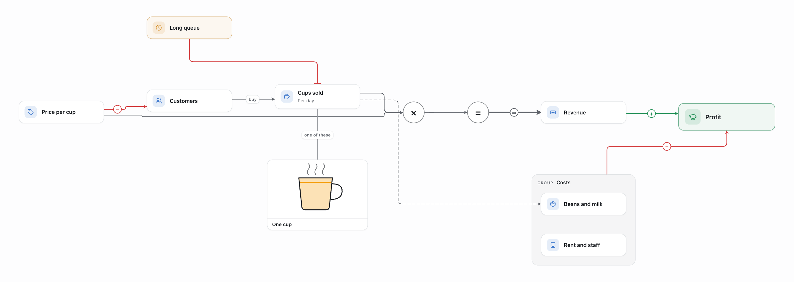

# Blueprint

A local Mac app for visual maps of ideas and systems, built to be drawn by your AI assistant and edited by hand.
You ask Claude Code, Cursor or Codex to `/visualize` something; it builds a canvas of cards, groups and typed
relationships (flow, increases, requires, blocks, …) in Blueprint, looks at a snapshot of what it drew, fixes it,
and opens it for you. Everything stays on your Mac as plain JSON files.



## Install (DMG)

1. Download `Blueprint.dmg` from the latest release (Apple silicon; signed and notarized).
2. Open it and drag **Blueprint** to **Applications**, then open Blueprint.
3. The first-run screen lists the AI tools it found (Claude Code, Cursor, Codex). Click **Connect**.
   You can do this later from **Blueprint > Connect AI tools…**, or from a terminal:

   ```sh
   /Applications/Blueprint.app/Contents/MacOS/Blueprint --connect --dry-run   # show the plan, change nothing
   /Applications/Blueprint.app/Contents/MacOS/Blueprint --connect            # apply it
   /Applications/Blueprint.app/Contents/MacOS/Blueprint --connect --tools claude,codex
   ```

Connecting backs up each tool's config file next to itself (`*.blueprint-backup-<time>`), adds a `blueprint` MCP
server that runs `Blueprint --mcp` (no Node.js needed), leaves every other server alone, and installs the
`visualize` skill plus the bundled `blueprint-*` method skills into `~/.claude/skills/` (Claude Code) and
`~/.agents/skills/` (Cursor and Codex). An existing skill with the same name is moved to a `skills-backups`
folder beside it, and the output says so. Restart the AI tool afterwards.

## Use

In your AI tool:

```
/visualize how our signup flow works, from landing page to first project
/visualize the tradeoffs between Postgres and DynamoDB for this service
```

Or just ask it to "map this in Blueprint". The assistant reads Blueprint's guide (and a method topic such as
`system-map`, `process-flow`, `feedback-map` or `options-compare`), writes the visual, checks a rendered
snapshot, and opens the app at it in the background. You can then drag, edit, connect, group and tidy by hand.

## Where your data lives

`~/Blueprint/projects/<project>/systems/<system>/visuals/<visual>.json`, plus images in each project's `assets/`.
Set `BLUEPRINT_HOME` to use another folder. Deleting in the app moves items to the Trash.

## Disconnect and uninstall

```sh
/Applications/Blueprint.app/Contents/MacOS/Blueprint --disconnect   # removes the server entries and the skills it installed
```

`--disconnect` puts back any skill that `--connect` moved aside. Then drag Blueprint.app to the Trash. Your
visuals in `~/Blueprint` are left in place; delete that folder too if you want them gone.

## Security model

- Local only: no accounts, no telemetry, no update checks; your files never leave the Mac.
- No network: DNS resolves nothing, all traffic goes to a dead local proxy, WebRTC cannot use UDP, and web requests are cancelled; a test proves an HTML visual cannot reach even 127.0.0.1.
- Sandboxed visuals: every window runs with the Chromium sandbox and context isolation; AI-drawn HTML runs in a script-only iframe with its own CSP; SVG is sanitised (no scripts, styles, foreignObject or external references).
- Contained files: the app and the MCP server refuse symbolic links and anything outside the store; `add_asset` reads only regular image files whose bytes match their extension.
- Hardened release: signed, notarized, hardened runtime with one entitlement (`allow-jit`), and Electron fuses that disable `ELECTRON_RUN_AS_NODE`, `NODE_OPTIONS` and the inspector.

## Build from source

Requires macOS on Apple silicon, Node.js 22+, and pnpm.

```sh
git clone <this repo> blueprint && cd blueprint
./setup.sh                 # installs deps (frozen lockfiles), builds, installs to /Applications, then offers --connect
./setup.sh --no-install    # build only; the app is in app/release/
```

From-source builds are ad-hoc signed. To produce a signed and notarized release, set
`BLUEPRINT_SIGN_IDENTITY` (a "Developer ID Application" identity name) and `APPLE_KEYCHAIN_PROFILE`
(a `xcrun notarytool store-credentials` profile) before `cd app && npm run package`.

The MCP server also runs straight from source with Node: `node mcp/dist/index.js`.

Tests: `cd mcp && npm run smoke` (MCP over stdio), `cd app && npm run test:ui` (interaction test against the
development build), `node app/scripts/network-test.mjs` and `node app/scripts/connect-test.mjs` (against the
packaged app in `app/release/`).

See [SPEC.md](SPEC.md) for the file format, tools and node/edge vocabulary.

## Credits and licence

MIT, see [LICENSE](LICENSE). The bundled skills adapt ideas from other open-source projects; see
[mcp/skills/ATTRIBUTION.md](mcp/skills/ATTRIBUTION.md).
